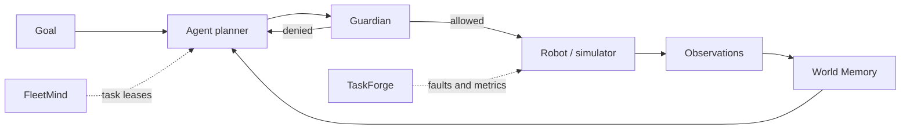

# Agentic Robotics Lab

[](https://github.com/NeuralNomad7/agentic-robotics-lab/actions/workflows/ci.yml)


[](LICENSE)

> Small, inspectable reference systems for four hard problems in agentic robotics:
> bounded authority, recovery-aware evaluation, memory under change, and coordination
> under partial failure.

The thesis: the next robotics breakthrough is less about another impressive one-shot demo
and more about an **agentic operating layer** that can turn uncertain perception and
high-level intent into accountable, recoverable physical action.

Each module isolates one problem, runs on a laptop with the standard library only, and is
small enough to read end to end (about 400 lines in total). They are reference designs,
not production controllers. The point is the interfaces, invariants and evaluation criteria.

## The four challenges

| Module | Hard problem | What it demonstrates |
|---|---|---|
| [`guardian`](src/agentic_robotics/guardian.py) | How can an open-ended agent act without bypassing hard safety constraints? | A policy gateway that fails closed, with three outcomes and a sequenced audit trail |
| [`taskforge`](src/agentic_robotics/taskforge.py) | How do we measure recovery, not just task completion? | Mission scoring where recovery is a metric and unsafe success cannot score well |
| [`world_memory`](src/agentic_robotics/world_memory.py) | What should a robot remember when the world changes underneath it? | Provenance-aware observations, confidence decay, contradiction handling |
| [`fleetmind`](src/agentic_robotics/fleetmind.py) | How do robots share work without one brittle central plan? | Capability-aware bidding, expiring leases, load tracking, heartbeat-driven reassignment |

## Quick start

```bash
python -m pip install -e .
python -m unittest discover -s tests -v
python examples/mission_demo.py
```

The demo runs one warehouse mission through fleet allocation, a safety check, a memory
lookup and a fault-injected evaluation:

```text
assigned robot : mobile-01
safety decision: allow
remembered kit : station-a
mission score  : 0.950
```

## 1. Guardian: runtime assurance

LLM and VLA planners are flexible on purpose; physical safety constraints cannot be.
`guardian` sits between an agent's proposal and the actuator interface.

```python
from agentic_robotics import Action, Guardian, Outcome

guardian = Guardian()
decision = guardian.evaluate(
    Action("move_base", {"speed_mps": 0.7}),
    context={"human_distance_m": 0.8, "estop": False},
)
assert decision.outcome == Outcome.DENY
assert decision.reasons == ("human_proximity",)
```

- **Fails closed.** Missing context, a rule that raises (for example a malformed
  parameter), or a NaN sensor reading all produce `DENY`, never `ALLOW`.
- **Three outcomes.** `ALLOW`, `DENY` and `REQUIRE_APPROVAL` (for example grasp force above
  25 N), rather than a false binary.
- **Explainable.** Every decision carries its reasons and a sequence number in the audit log.

## 2. TaskForge: long-horizon evaluation

Success rate hides what matters in deployment: detection, recovery, efficiency and safe
degradation. `taskforge` scores a mission as checkable steps run by any agent function,
with named faults passed in.

The report gives completion rate, recovery rate, unsafe-action count, interventions,
efficiency (steps per attempt) and a composite score. Unsafe actions and interventions
divide the whole score, so a mission completed unsafely always scores below the same
mission completed safely.

## 3. World Memory: grounded robot memory

Robots need memory, but stale certainty is dangerous. `world_memory` keeps an append-only
log of observations (source, time, confidence, location) and derives a belief at query time.

```python
from agentic_robotics import WorldMemory

memory = WorldMemory()
memory.observe("mug", "on_table", confidence=0.92, source="wrist_camera", location="kitchen")
memory.observe("mug", "in_sink", confidence=0.81, source="overhead_camera", location="kitchen")

belief = memory.recall("mug", location="kitchen")
assert belief.value == "in_sink"
```

- Confidence decays with a configurable half-life.
- An observation contradicted by a newer one keeps only part of its weight
  (`contradiction_discount`, 0.5 by default), so a fresh report beats a stale, more
  confident one. Repeated agreement can still outvote a single noisy contradiction.
- Nothing is deleted; the full history stays available for audit.

## 4. FleetMind: multi-robot coordination

Central scheduling is easy until a robot drops off the network mid-task. `fleetmind` uses
a compact contract-net style auction with expiring leases.

- Robots bid on capability match, distance, battery and current load.
- Each lease raises the winner's load; release and reassignment lower it, so work spreads.
- A missed heartbeat or a battery under 15% makes a robot ineligible, and its tasks are
  reassigned on the next allocation.

## System view



## Engineering principles

1. **Separate intelligence from authority.** A model can propose; a bounded runtime decides
   what may execute.
2. **Evaluate the recovery loop.** Real autonomy begins after the first plan fails.
3. **Treat confidence as perishable.** Memory must expose provenance, age and contradiction.
4. **Design for partial failure.** Coordination should degrade gracefully when a robot or
   link is lost.
5. **Prefer inspectable baselines.** Every sophisticated system deserves a small reference
   implementation you can reason about end to end.

## Repository map

```text
src/agentic_robotics/
  guardian.py       policy gateway and audit decisions
  taskforge.py      mission runner and autonomy metrics
  world_memory.py   temporal, provenance-aware belief store
  fleetmind.py      auction, lease and reassignment logic
examples/
  mission_demo.py   end-to-end warehouse mission
tests/              executable design contracts (20 tests)
docs/
  challenge-map.md  research context and extension paths
```

## Roadmap

- [ ] ROS 2 action-server adapter for Guardian
- [ ] MuJoCo / Isaac Lab environment adapter for TaskForge
- [ ] SQLite and spatial-index backends for World Memory
- [ ] Async transport and packet-loss tests for FleetMind
- [ ] OpenTelemetry mission traces and a small evaluation dashboard

## Research context

Informed by [RT-2](https://robotics-transformer2.github.io/),
[Open X-Embodiment](https://robotics-transformer-x.github.io/),
[PaLM-E](https://palm-e.github.io/), [BEHAVIOR-1K](https://behavior.stanford.edu/),
[RoboCasa](https://robocasa.ai/) and [LeRobot](https://github.com/huggingface/lerobot).
[docs/challenge-map.md](docs/challenge-map.md) maps each module to a production research
question and a validation path.

## Why this repo exists

It shows how I break an ambiguous frontier problem into interfaces, invariants, evaluation
criteria and an incremental delivery path that a multidisciplinary team can execute. If you
work on embodied agents, robotics platforms or production autonomy, I'd enjoy comparing notes.

## License

MIT
